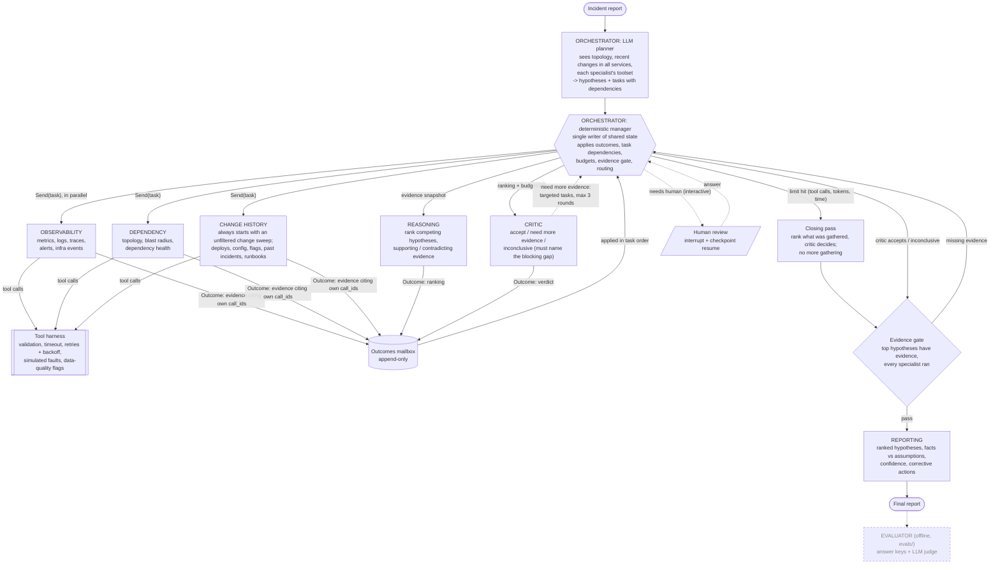
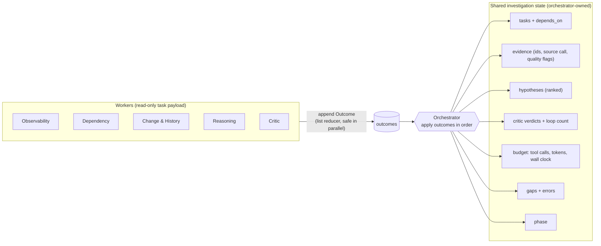
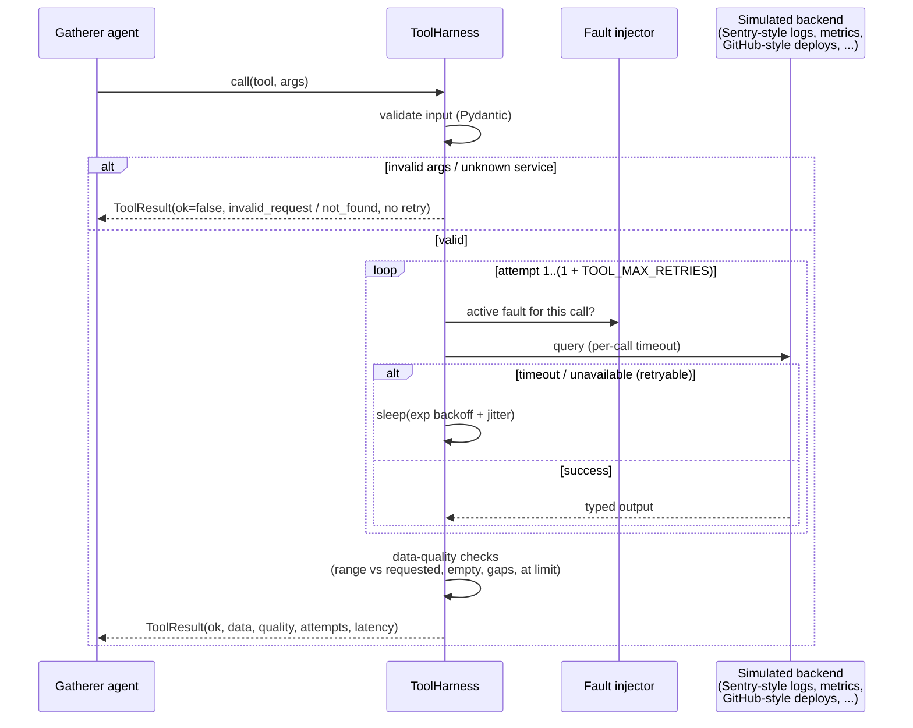
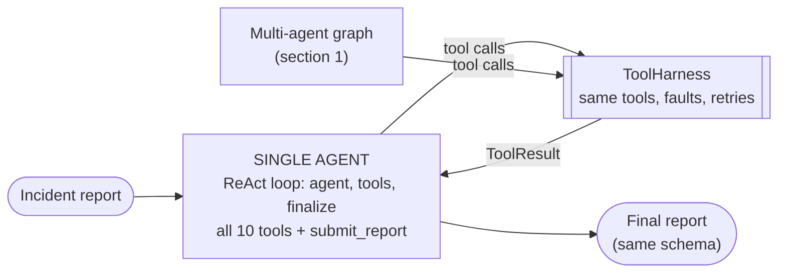
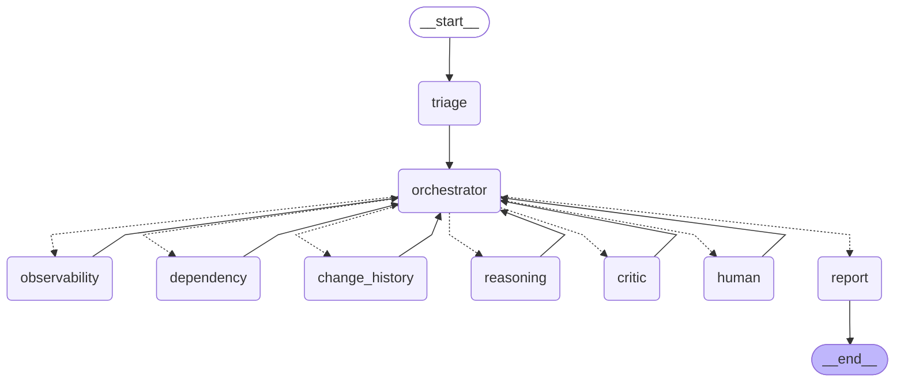

# Architecture (Mermaid)

Based on `planning.md` and `initial_architecture.png`, with the agreed review decisions applied: orchestrator as the single writer, three parallel gatherers, and critic loops routed through the orchestrator. The single-agent baseline (section 4) is the comparison system. The evaluator runs offline in `evals/`, outside the graph.

Mapping to the brief's roles: Orchestrator = `triage` (LLM planner) + `orchestrator` (deterministic manager); Observability Agent = `observability`; Dependency Agent = `dependency` (service dependencies) together with `change_history` (deployments and configuration changes), split so each keeps a short, focused toolset; Reasoning, Critic and Reporting Agents = `reasoning`, `critic`, `report`.

## 1. Agent graph

**Critic verdicts**, all applied by the orchestrator:
- `need_more_evidence(requests)`: new targeted tasks for the gatherers, at most 3 loops. The critic sees which
  specialist holds which tools and the remaining budget, and only asks questions a tool can answer.
- `needs_human`: interactive mode interrupts. In eval mode the critic is told no human is available.
- `accept` or `inconclusive`: go to the evidence gate. `inconclusive` must name a blocking gap or an equally
  supported competing hypothesis; otherwise the orchestrator treats it as accept (and logs that).

**How the agents collaborate**:
- The planner sees the topology, an unfiltered list of recent changes in all services and each specialist's
  toolset, and turns the incident into hypotheses and tasks with dependencies.
- Specialists work in parallel on their own short contexts. Each brief carries the hypotheses under test, the
  team's evidence so far and every query already run, so re-dispatched work builds on earlier results.
- Every result is a typed `Outcome`. The orchestrator turns outcomes into shared state; evidence that cites a
  tool call the worker did not make is dropped.
- The reasoner ranks hypotheses on the shared evidence; the critic challenges the ranking and sends targeted
  requests back through the orchestrator, which becomes the next round of tasks.

## 2. Shared state, single writer

## 3. Tool call path, reliability

## 4. Single-agent baseline (required)

The comparison system: one tool-calling agent (`investigator/baseline.py`) with the same `ToolHarness`, tool rendering, budgets, metering and report schema, so the only difference is the orchestration (no planner, specialists, evidence gate or critic). It's a plain ReAct loop (`start -> agent <-> tools -> finalize`, plus `nudge`/`budget` steps that ask it to submit). It's built on our own loop rather than `create_agent` so tool handling and metering are identical to the multi-agent system. Facts in its report must cite tool `call_id`s and are converted into the same evidence index; fabricated call ids are dropped.

Both systems record tool calls, tokens and latency per run. That's what the comparison uses: root-cause accuracy, evidence grounding, tool-call count, latency and token consumption.

## 5. Compiled LangGraph (generated)

Generated from the built graph with `build_graph(...).get_graph().draw_mermaid()`. Dashed edges are dynamic `Command`/`Send` routes chosen by the orchestrator. `triage` is the orchestrator's LLM-planner step, kept as its own node so a planner failure can fall back to default coverage.

## Termination and limits
| Limit | Default | When hit |
|---|---|---|
| Critic loops | 3 | go to evidence gate, then report with gaps listed |
| Any run limit (tool calls, tokens, wall clock) | see below | one closing pass: rank what was gathered, the critic decides accept or inconclusive; no more gathering. Accepting still needs the evidence gate |
| Tool retries per call | 2 (`TOOL_MAX_RETRIES`) | tool result becomes an evidence gap |
| Tool timeout | 10s (`TOOL_TIMEOUT_S`) | retried, then a gap |
| Tool calls per run | 60 (`BudgetLimits.max_tool_calls`) | stop gathering, closing pass, report |
| Wall clock / tokens | 600s / 400k tokens | stop gathering, closing pass, report |
| Tasks per round | 6 | extra planner/critic requests dropped (logged) |
| Tool calls per task | 8 | further calls return `budget_exhausted` |
| Worker attempts | 2 | then `Outcome(failed)`; investigation continues |
| Evidence gate | top 3 hypotheses need evidence + all 3 gatherers ran | targeted gap tasks while loops remain |
| LangGraph `recursion_limit` | backstop | hard stop |
