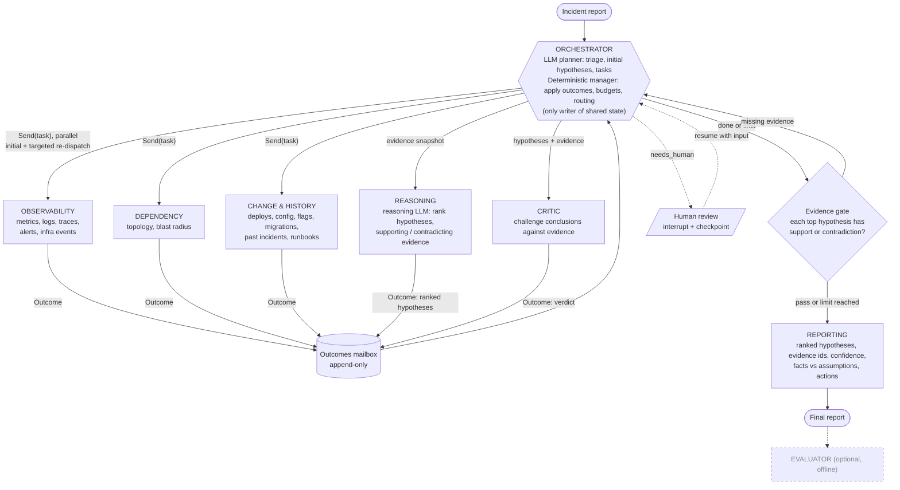
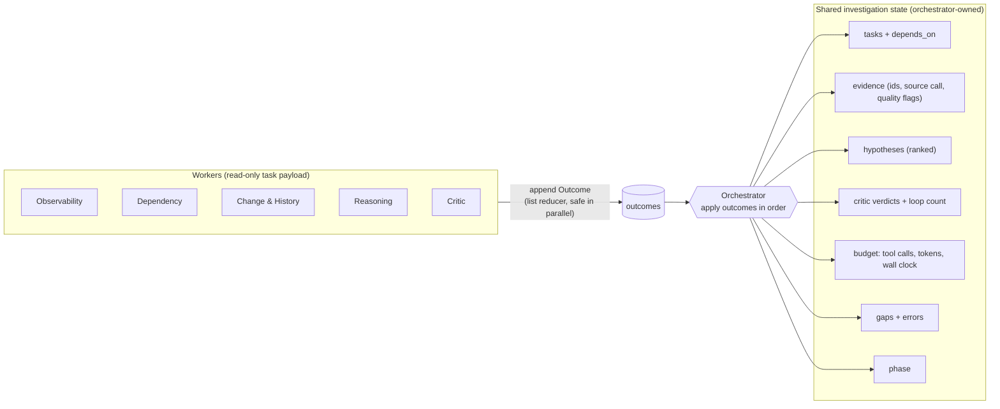
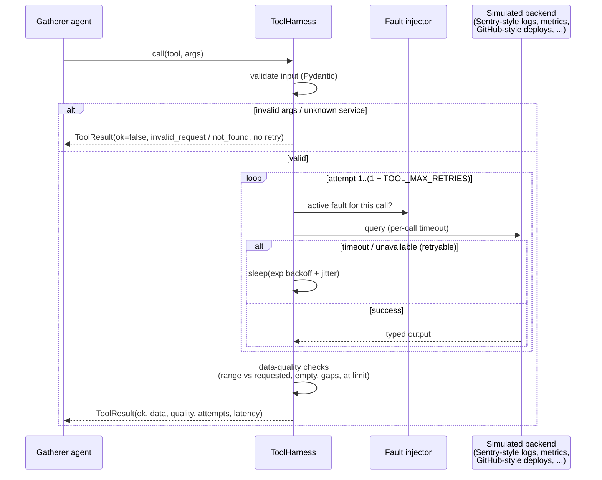
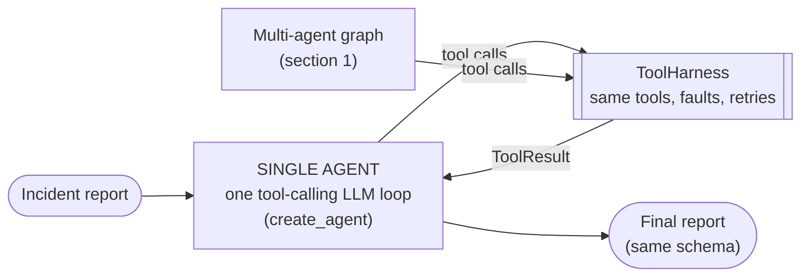

# Architecture (Mermaid)

Based on `planning.md` and `initial_architecture.png`, with the agreed review decisions applied: orchestrator as the single writer, three parallel gatherers, and critic loops routed through the orchestrator. The **single-agent baseline is required**. Only the **evaluator** is optional/deferred.

## 1. Agent graph

**Critic verdicts**, all applied by the orchestrator:
- `need_more_evidence(requests)`: new targeted tasks for the gatherers, at most 3 loops.
- `needs_human`: interactive mode interrupts; eval mode produces an inconclusive report with the open questions.
- `accept` or `inconclusive`: go to the evidence gate.

## 2. Shared state, single writer

## 3. Tool call path, reliability

## 4. Single-agent baseline (required)

The comparison system: one tool-calling agent with the same `ToolHarness`, tools, budgets and report schema, so the only difference is the orchestration.

Both systems record tool calls, tokens and latency per run. That's what the comparison uses: root-cause accuracy, evidence grounding, tool-call count, latency and token consumption.

## Termination and limits
| Limit | Default | When hit |
|---|---|---|
| Critic loops | 3 | go to evidence gate, then report with gaps listed |
| Tool retries per call | 2 (`TOOL_MAX_RETRIES`) | tool result becomes an evidence gap |
| Tool timeout | 10s (`TOOL_TIMEOUT_S`) | retried, then a gap |
| Tool calls per run | 60 (`BudgetLimits.max_tool_calls`) | stop gathering and report |
| Wall clock / tokens | 600s / 400k tokens | stop gathering and report |
| Tasks per round | 6 | extra planner/critic requests dropped (logged) |
| Evidence gate | top 3 hypotheses need evidence + all 3 gatherers ran | targeted gap tasks while loops remain |
| LangGraph `recursion_limit` | backstop | hard stop |
